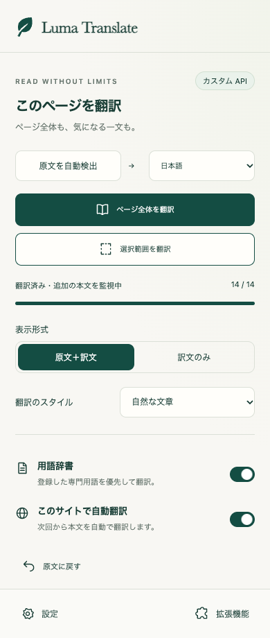
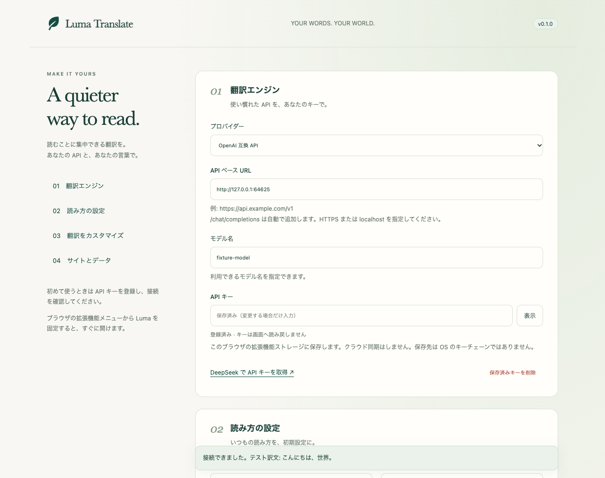

# Luma Translate

ページ全体も、選んだ一文も。自分の DeepSeek API で、読むことに集中できるブラウザ翻訳。

[](https://github.com/aimasteracc/luma-translate/actions/workflows/ci.yml)
[初版をダウンロード](https://github.com/aimasteracc/luma-translate/releases/tag/v0.1.0) · [拡張方法](docs/EXTENDING.md) · [検証記録](docs/QA.md)

Chrome / Edge 向けの Manifest V3 拡張機能です。実行時の外部ライブラリ・ビルド工程・独自サーバーは不要です。Immersive Translate の公開機能を参考にした独自実装であり、同製品のコードやブランドの複製ではありません。

## 画面



<details>
<summary>設定画面を見る</summary>



</details>

画像は実装済み UI のキャプチャです。ローカルテスト用の API 設定を含みます。

## インストール

**[Releases](https://github.com/aimasteracc/luma-translate/releases) から `luma-translate-0.1.0.zip` をダウンロードして展開**するか、このリポジトリを取得してください。Chrome ウェブストアでの配布はまだ行っていません。

1. Chrome で `chrome://extensions`（Edge は `edge://extensions`）を開きます。
2. 「デベロッパーモード」をオンにします。
3. 「パッケージ化されていない拡張機能を読み込む」を押します。
4. このプロジェクトの **`extension` フォルダ**を選びます。`manifest.json` が入っているフォルダです。
5. ブラウザの拡張機能メニューから **Luma Translate を固定**します。

ZIP を使う場合は `dist/luma-translate-0.1.0.zip` を展開し、展開先の `manifest.json` があるフォルダを読み込みます。ZIP 自体を選択する必要はありません。

## 最初の設定

1. 通常の Web ページを開き、ツールバーの Luma アイコンを押します。
2. パネルの「API キーを設定」または「設定」を開きます。
3. プロバイダーを **DeepSeek** にして、ご自身の API キーを入力します。
4. モデルの初期値は `deepseek-flash` です。契約で利用できる別のモデル名にも変更できます。
5. **「保存して接続を確認」**を押します。短いテスト文章を API に送信するため、通常の API 利用料金が発生します。

API キーをソースコードやチャットに貼る必要はありません。保存後のキーは設定画面に読み戻しません。空欄で保存すると登録済みキーを維持し、「保存済みキーを削除」で削除できます。

## 使い方

| 操作 | 方法 |
| --- | --- |
| ページ全体を翻訳 | Luma パネルの「ページ全体を翻訳」 |
| 選択範囲を翻訳 | 文章を選択して浮かぶボタン、右クリックメニュー、またはパネル |
| 原文も一緒に読む | 「原文＋訳文」 |
| 訳文だけにする | 「訳文のみ」 |
| 中断 | 翻訳中の「翻訳を中断」。翻訳済みの箇所は残ります |
| 再開 | 中断後に「ページ全体を翻訳」。未完了の箇所を処理します |
| エラーの再試行 | 「失敗した箇所を再試行」 |
| 元のページに戻す | 「原文に戻す」。本文監視も停止します |
| サイトごとに自動翻訳 | 「このサイトで自動翻訳」をオンにし、そのサイトへのアクセスを許可 |
| 用語・文体を調整 | 設定の「翻訳をカスタマイズ」 |

ショートカットは `Alt+Shift+L`（全文）と `Alt+Shift+S`（選択）。Mac は Alt の代わりに Option キーです。競合している場合は `chrome://extensions/shortcuts` で変更してください。

自動翻訳は、許可したサイトの次回読み込みから有効になります。初期状態では、どのサイトの文章も自動送信しません。別のタブに移ったとき、必要に応じてそのタブで Luma アイコンを押し、アクセスを有効にしてください。

ページに後から追加された本文も監視して翻訳します。翻訳条件を変更すると、すでに挿入された訳文を一旦取り除きます。「ページ全体を翻訳」で新しい条件を適用してください。表示形式の切り替えだけでは再翻訳しません。

## OpenAI 互換 API

「プロバイダー」で OpenAI 互換 API を選択し、ベース URL・モデル・その接続先の API キーを指定します。例えばベース URL が `https://example.com/v1` の場合、`/chat/completions` に POST します。

- HTTPS が必須です。ローカル開発用の `localhost` / `127.0.0.1` / `::1` だけは HTTP を許可します。
- 接続先のホスト権限は保存操作時に求めます。
- 接続先を変更した際は、その接続先用の API キーを入力してください。既存のキーを新しい接続先へ自動流用しません。
- 標準の `messages` / `model` / `max_tokens` を受け付け、`choices[0].message.content` を返す API が対象です。すべての互換 API との動作を保証するものではありません。

## データの取り扱い

- API キーと設定は `chrome.storage.local` に保存します。クラウド同期しません。OS キーチェーン相当の暗号化保管ではありません。
- ストレージへのアクセスを `TRUSTED_CONTEXTS` に限定します。閲覧ページの content script へ API キーを返すメッセージはありません。
- 翻訳する文章、言語、用語辞書、カスタムプロンプトを設定先の API に送信します。通常のページ URL や Cookie は翻訳 API のリクエストに付与しません。
- フォーム入力、編集可能領域、コードブロック、`translate="no"` の領域は全文翻訳から除外します。
- 訳文はバックグラウンドのメモリに最大 100 件キャッシュします。永続的な翻訳履歴・アクセス解析は保存しません。
- API の料金・保存・学習利用などの取り扱いは、ご利用のプロバイダーの条件に従います。
- ページ本文や API の応答を HTML として実行しません。訳文は `textContent` で挿入します。
- 通常の翻訳は、そのタブへの一時的アクセスで動作します。自動翻訳を選んだサイトだけ永続的なアクセス許可を追加します。

## 初版の対応範囲

通常の HTTP / HTTPS ページの、メインフレームの DOM 本文が対象です。以下は対象外、または未検証です。

- PDF ビューアー、画像 OCR、字幕、Canvas に描画された文字。
- iframe 内、サイト自身の Shadow DOM 内の本文。
- ブラウザ内部ページ、拡張機能ページ、Chrome ウェブストアなど、ブラウザが注入を禁止するページ。
- 複雑な独自エディターや独自レンダラーとの完全互換性。
- Safari / Firefox / モバイルへの拡張機能インストール。

1 回の選択は最大 20,000 文字、全文翻訳は現在のセッションで最大 500 箇所です。大きすぎるブロックは全文処理から除外し、範囲選択で翻訳できます。2 並列で処理し、API リクエストは 2,200 文字を目安に分割します。長い文章は分割位置をまたぐ文脈が失われる可能性があります。各リクエストのタイムアウトは 25 秒です。

選択翻訳を開始すると、実行中の全文翻訳を中断します。既存の訳文は残します。ポップアップを閉じるには × または Escape を使います。

## 拡張する

DeepSeek Harness の「プラグイン中心」という考え方を参考に、翻訳エンジンと翻訳指示を分離しています。Harness プラグインの実行互換性はありません。

- `extension/providers/index.js`: 翻訳エンジンのレジストリと実装。インターフェースは `translate(text, config, apiKey, signal) => Promise<string>`。
- `extension/core/plugins.js`: 用語辞書・カスタムプロンプトのプラグイン。`id`、`enabled(config)`、`instructions(config)` を持ちます。キーや DOM にはアクセスしません。
- `extension/core/config.js`: 設定検証、プロンプト組み立て、分割、キャッシュキー。
- `extension/background.js`: キー保管、API 呼び出し、キャンセル、権限、登録スクリプト。
- `extension/content.js`: 本文収集、訳文表示、選択 UI、原文復帰。
- `extension/panel.*` / `settings.*`: 操作パネル・設定画面。

追加方法と互換性の境界は [docs/EXTENDING.md](docs/EXTENDING.md) を参照してください。初版はパッケージに同梱するモジュール方式です。インターネットから任意の JavaScript を取得して実行するプラグイン市場は含みません。

## 開発・テスト

拡張機能の実行には npm install は不要です。テストのみ Node.js と Playwright を使います。

```sh
npm ci
npm test
npx playwright install chromium
npm run test:browser
npm run package
```

`CHROMIUM_PATH` を指定して既存の Chromium バイナリを使うこともできます。macOS では既存の Playwright キャッシュも探します。

ブラウザテストは、専用の一時プロファイルとローカルのテスト用 API を使います。配布ファイルは変更せず、一時コピーだけにローカルホストの権限を追加します。実際の DeepSeek に送信せず、実キーや料金は不要です。

GitHub Actions でも単体テスト・ブラウザテスト・ZIP 作成を実行します。CI へ API キーを登録する必要はありません。

画面キャプチャと検証結果は `test-results/` に出力されます。実際の DeepSeek API での疎通・翻訳品質・すべての Web サイトとの互換性は、このテストでは検証しません。

## 参考にした一次資料

- https://immersivetranslate.com/ja/
- https://api-docs.deepseek.com/
- https://developer.chrome.com/docs/extensions/reference/api/sidePanel
- https://developer.chrome.com/docs/extensions/reference/api/storage
- https://github.com/deepseek-ai/deepseek-harness
- https://github.com/nextlevelbuilder/ui-ux-pro-max-skill

公開ページの REA 調査と、承認済みの画面イメージを元に作成しました。元の拡張機能の非公開ロジックを再現したという主張ではありません。
